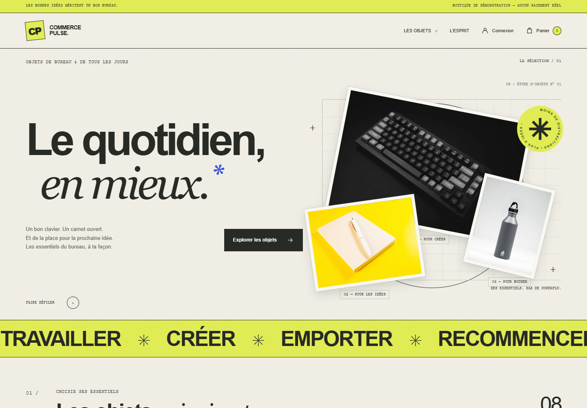
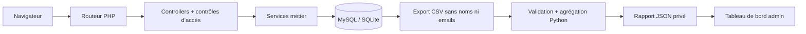
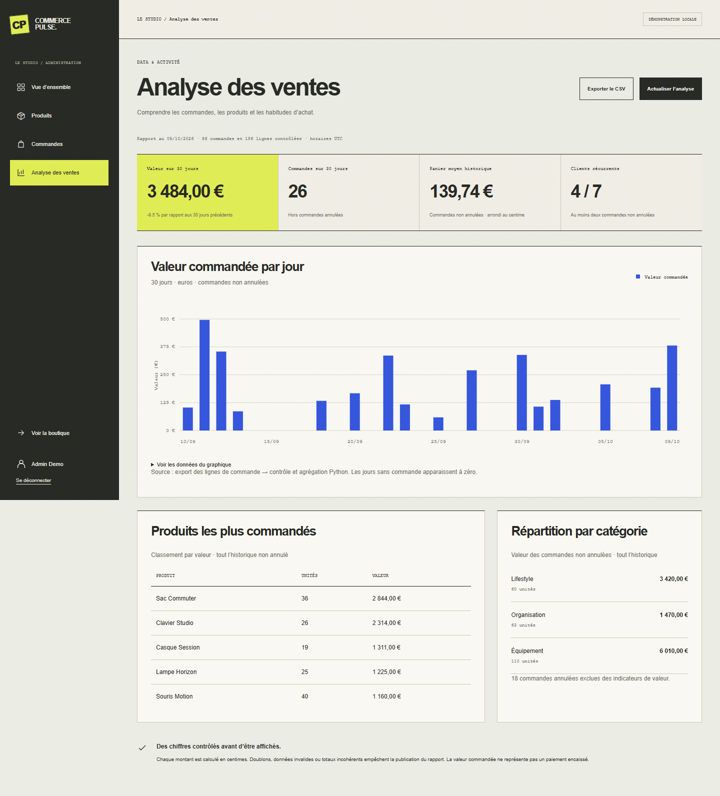

# Commerce Pulse

Une boutique e-commerce de démonstration avec un back-office et une chaîne d’analyse des ventes. Projet portfolio de **Mehdi Bictogo**, orienté développement **backend/web junior** et **Data junior**.

**PHP 8.4+ · MySQL 8.4 · JavaScript · Python 3.11+ · Docker Compose**

**Version 1.0.0 — démonstration portfolio.** Les parcours ont été vérifiés localement avec SQLite : 193 contrôles navigateur, 15 scénarios HTTP, 20 assertions PHP et 10 tests Python. La configuration Docker/MySQL est fournie ; son exécution reste à valider sur une machine avec un moteur Docker fonctionnel. Voir [les résultats et limites des tests](docs/TESTING.md).



## Une boutique comme un atelier d’objets

Une identité éditoriale dédiée aux essentiels du bureau : papier crème, encre noire, jaune vif et accents bleu cobalt. La composition mêle grandes lettres, détails de catalogue, photos de produits et grille décalée. L’accueil superpose des tirages photo ; l’inscription prend la forme d’une affiche ; l’administration reprend les mêmes repères graphiques.

Les effets accompagnent la navigation : objets réactifs au pointeur, relief léger sur les produits, apparitions au défilement, ruban animé et retour visuel sur les boutons. La préférence système de réduction des mouvements est respectée, et le catalogue comme les formulaires restent utilisables sans JavaScript. Les huit photos sont issues d’Unsplash, optimisées en WebP et stockées dans le projet : aucun service de polices ou d’images externe n’est nécessaire à l’exécution. Voir [les crédits photographiques](CREDITS.md).

Voir [les choix de design](docs/DESIGN.md) et [l’écran d’inscription](docs/screenshots/register.png).

Pour une visite de cinq minutes, suivre [le parcours de démonstration](docs/DEMO.md). Les changements de la version sont décrits dans [le journal des versions](CHANGELOG.md).

## Ce que l’on peut essayer

- Catalogue : recherche, catégories, tri, pagination et fiches produit.
- Compte client : inscription, connexion, panier et historique des commandes.
- Commande : prix calculés côté serveur, contrôle du stock et protection contre les doubles confirmations.
- Administration : création/modification/archivage des produits, gestion du stock et cycle des commandes.
- Analyse : export CSV, validation Python, indicateurs de vente, graphique quotidien et classement des produits.
- API JSON de catalogue, point de santé, tests métier et parcours HTTP, intégration continue GitHub Actions.

Les produits, comptes et commandes de démonstration sont fictifs. Il n’y a pas de paiement, d’email transactionnel ni de livraison réelle.

## Lancer avec Docker — environnement principal MySQL

Prérequis : Docker Desktop démarré avec le moteur Linux et Docker Compose.

```sh
git clone https://github.com/BicMehdi/commerce-pulse.git
cd commerce-pulse
cp .env.example .env
docker compose up --build -d --wait
```

Sous PowerShell, remplacer `cp .env.example .env` par `Copy-Item .env.example .env`.

Ouvrir **http://localhost:8090**. La première exécution applique le schéma, crée 8 produits, 5 utilisateurs fictifs et 90 commandes historiques, puis génère le rapport Python. Les démarrages suivants conservent les données.

Comptes de démonstration, uniquement pour cette instance locale :

- Client : `alex@commercepulse.test`
- Administrateur : `admin@commercepulse.test`
- Mot de passe initial : `Demo-Pulse-2026!` (variable `DEMO_PASSWORD`, utilisée lors du premier seed).

Le port HTTP est lié à `127.0.0.1`. MySQL n’expose aucun port sur l’hôte.

```sh
docker compose logs -f app
docker compose exec app php bin/export-sales.php
docker compose exec app python3 analytics/pipeline.py --input storage/exports/sales.csv --output storage/reports/sales.json
docker compose down
```

Les volumes conservent la base et les rapports. Changer le mot de passe de démonstration dans `.env` ne modifie pas les comptes déjà créés.

## Alternative légère : PHP + SQLite

Pour explorer l’interface sans Docker : PHP 8.4+ avec PDO SQLite et Python 3.11+ doivent être installés. Le chemin SQLite utilise le même domaine métier, mais **ne démontre pas les verrous de concurrence MySQL**.

PowerShell :

```powershell
.\bin\dev.ps1
# Ou : .\bin\dev.ps1 -Php 'C:\chemin\vers\php.exe'
```

Linux/macOS :

```sh
export DB_DRIVER=sqlite APP_ENV=local APP_DEMO=1
php bin/migrate.php
php bin/seed.php
php bin/export-sales.php
python3 analytics/pipeline.py --input storage/exports/sales.csv --output storage/reports/sales.json
php -S 127.0.0.1:8090 -t public public/router.php
```

## Architecture

```text
public/         Point d’entrée HTTP, CSS, JavaScript, SVG et photos WebP locales
app/Core/       PDO, sessions, authentification, réponses HTTP
app/Controllers/Coordination des requêtes, contrôles d’accès, vues
app/Domain/     Validation des produits et transitions des commandes
app/Services/   Catalogue, panier, commandes et export des ventes
views/          Templates PHP avec échappement HTML
database/       Schémas MySQL / SQLite et contraintes relationnelles
bin/            Migration, données fictives, export et démarrage local
analytics/      Validation et agrégation Python, tests de qualité des données
tests/          Assertions PHP, parcours HTTP et tests navigateur
docs/           Architecture, données, tests et guide d’entretien
```

Pas de dépendance applicative PHP ou JavaScript : un autoloader simple et PDO suffisent. Le pipeline Python utilise la bibliothèque standard. C’est un choix de lisibilité pour comprendre le parcours complet d’une requête avant de migrer vers un framework.



## Les compétences démontrées

- **PHP / MVC** : routes, contrôleurs, services et vues séparés.
- **SQL / MySQL** : tables relationnelles, clés étrangères, contraintes, index, agrégations et transactions.
- **Authentification** : `password_hash`, vérification des mots de passe, rotation de session, cookies HttpOnly et contrôle des rôles.
- **E-commerce** : panier en session, prix en centimes, snapshots des lignes de commande, annulation avec restitution du stock.
- **JavaScript / HTML / CSS** : direction visuelle originale, interface responsive, animations progressives, formulaires accessibles et graphique Canvas avec alternative tabulaire.
- **Python / Data junior** : contrat CSV, contrôles de qualité, reconciliation des totaux, périodes comparables et publication atomique du rapport.
- **Git / Docker / tests** : dépôt reproductible, environnement de démonstration et vérifications automatisées.

Voir [le guide pour expliquer le projet](docs/LEARNING.md) et [les décisions techniques](docs/ARCHITECTURE.md).



Le contrat HTTP est décrit dans [la documentation API](docs/API.md).

## Tester

```sh
docker compose exec app php tests/run.php
docker compose exec app python3 -m unittest discover -s analytics -p 'test_*.py' -v
python3 tests/http_smoke.py --base-url http://127.0.0.1:8090
node --check public/assets/app.js
```

Tests navigateur (Node.js 20+ et instance locale démarrée) :

```sh
npm ci
npx playwright install chromium
npm run test:browser
```

Pour utiliser Edge déjà installé sous Windows, remplacer l’installation de Chromium par `$env:BROWSER_CHANNEL='msedge'` avant `npm run test:browser`. Le script accepte `BASE_URL` pour un autre port local. Playwright est uniquement une dépendance de développement.

Les tests HTTP créent quelques comptes/commandes fictifs : les exécuter sur une instance locale de démonstration. Les tests PHP de base de données refusent une base ordinaire ; ils nécessitent `APP_ENV=testing` et une base dédiée se terminant par `_test` (MySQL) ou `.test.sqlite`.

Le workflow [CI](.github/workflows/ci.yml) prépare MySQL, lance les tests PHP avec une base séparée, les tests Python, les parcours HTTP et les interactions navigateur sur cinq largeurs d’écran. Voir [la procédure détaillée](docs/TESTING.md).

## Lire les chiffres correctement

La « valeur commandée » est la somme des commandes non annulées, **pas un chiffre d’affaires encaissé**. Le panier moyen est historique ; la variation compare deux fenêtres de 30 jours en UTC. Les journées sans commande sont présentes à zéro. Le pipeline refuse de publier si une ligne est dupliquée ou si un total de commande ne correspond pas à ses lignes. Les identifiants clients sont pseudonymes ; l’export n’est pas une anonymisation complète.

## Périmètre et suites possibles

La version 1.0 couvre le parcours e-commerce simulé et l’analyse des ventes décrits ci-dessus. Le projet a été réalisé avec l’assistance de Codex et est destiné à être étudié et expliqué par son auteur.

Un déploiement en production constituerait une évolution distincte : serveur adapté, récupération de mot de passe, confirmation d’email, tests de charge/concurrence, gestion des taxes/livraisons et éventuellement prestataire de paiement en environnement de test. Le serveur intégré PHP et les identifiants de démonstration sont réservés au local.

Les implémentations s’appuient sur la [documentation PHP/PDO](https://www.php.net/manual/en/pdo.prepared-statements.php), les [verrous MySQL](https://dev.mysql.com/doc/refman/8.4/en/innodb-locking-reads.html), la [bibliothèque CSV Python](https://docs.python.org/3/library/csv.html) et [Docker Compose](https://docs.docker.com/compose/gettingstarted/).
